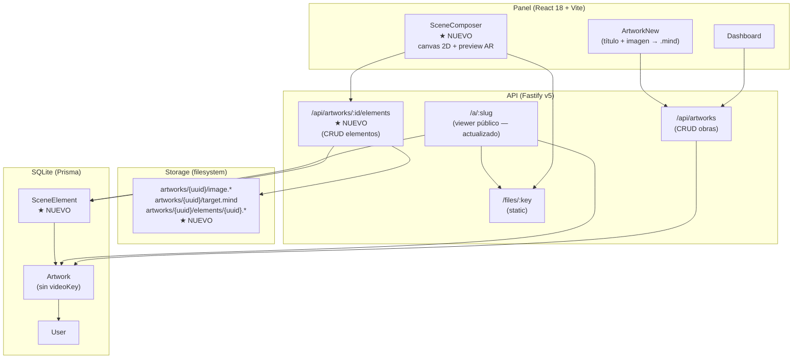
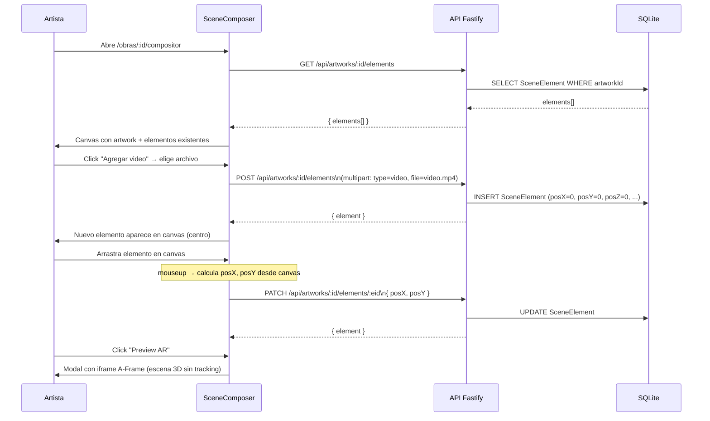

# Plan de Desarrollo: Compositor de Escenas AR

> Generado el 2026-10-13 mediante entrevista guiada.
> Modo: completo
> Tipo de proyecto: existente
> Tipo (capa): fullstack
> Ubicación: `docs/planning/fullstack/compositor-de-escenas.md`

---

## 0. Contexto heredado

| Aspecto | Decisión heredada | Fuente |
|---|---|---|
| Lenguaje / Runtime | Node.js 20 + TypeScript | `apps/api/package.json` |
| Framework API | Fastify v5 | `apps/api/package.json` |
| Framework Panel | React 18 + Vite + React Router v6 | `apps/panel/package.json` |
| Base de datos | SQLite | `apps/api/prisma/schema.prisma` |
| ORM | Prisma v5 | `apps/api/package.json` |
| Auth | JWT via `@fastify/jwt` — rutas protegidas con `fastify.authenticate` | `apps/api/src/routes/auth.ts` |
| Storage | Filesystem local — `fastify.storage.save/delete`, servido en `/files/:key` | `apps/api/src/plugins/storage.ts` |
| Viewer público | `/a/:slug` genera HTML con A-Frame + MindAR | `apps/api/src/routes/viewer.ts` |
| UI del panel | CSS vanilla, sin librería de componentes | `apps/panel/src/` |
| AR runtime | MindAR 1.2.5 + A-Frame 1.5.0 | `apps/panel/package.json`, `viewer.ts` |
| Convenciones API | REST bajo `/api/`, respuestas `{ artwork }` / `{ artworks }` | `apps/api/src/routes/artworks.ts` |
| Despliegue | Docker + docker-compose + Traefik | `docker-compose.yml`, `build.sh` |
| Testing | Vitest (sin cobertura mínima forzada) | `apps/api/package.json` |

### Excepciones acordadas en esta sesión

- **`videoKey` eliminado de `Artwork`** — el video deja de ser un campo directo de la obra; ahora es un `SceneElement` de tipo `video`. Razón: el modelo multi-elemento reemplaza la relación 1-a-1 obra/video. No hay obras existentes en producción, por lo que no se requiere migración de datos.

---

## 1. Resumen ejecutivo

**Problema que resuelve:** El visor AR actual solo puede mostrar un video por obra, sin posibilidad de posicionar, escalar o combinar múltiples tipos de contenido. El artista no tiene forma de componer la escena antes de publicar — publica a ciegas.

**Tipo de sistema:** Fullstack (API REST + SPA React)

**Usuarios objetivo:** BTAJ (artista, único usuario del panel) y el público general que escanea QRs para ver el visor AR.

**Alcance de esta feature:**
- El panel incluirá un compositor visual con canvas 2D donde el artista posiciona elementos sobre la imagen de la obra.
- Los tipos de elemento soportados son: video (mp4), imagen estática (jpg/png/webp) y modelo 3D (glb).
- Una vista previa AR embebida (A-Frame sin tracking) permite ver la escena antes de publicar.
- El visor público (`/a/:slug`) renderizará todos los elementos de la escena con sus posiciones/escalas/rotaciones.

---

## 2. Stack técnico

### Decisiones principales

| Componente | Elección | Origen | Justificación |
|---|---|---|---|
| Lenguaje / Runtime API | Node.js 20 + TypeScript | `[heredado]` | Regla del proyecto, ver `apps/api/package.json` |
| Framework API | Fastify v5 | `[heredado]` | Regla del proyecto |
| Base de datos | SQLite | `[heredado]` | Regla del proyecto |
| ORM | Prisma v5 | `[heredado]` | Regla del proyecto |
| Auth | JWT via `@fastify/jwt` | `[heredado]` | Regla del proyecto |
| Framework Panel | React 18 + Vite | `[heredado]` | Regla del proyecto |
| AR runtime (viewer) | A-Frame 1.5.0 + MindAR 1.2.5 | `[heredado]` | Ya en uso en viewer.ts |
| Preview AR (compositor) | A-Frame embebido en `<iframe>` | `[nuevo]` | Reutiliza el mismo runtime; aislamiento de estilos y eventos via iframe |
| Drag & drop canvas | HTML5 Canvas + eventos de mouse/touch nativos | `[nuevo]` | Sin dependencias extra; suficiente para canvas 2D simple |
| Despliegue | Docker + docker-compose | `[heredado]` | Pipeline existente |

### Dependencias clave

- `mind-ar` — compilación de imagen a `.mind` en el browser (ya existe)
- `@fastify/multipart` — upload de archivos (ya existe)
- `@fastify/static` — servir archivos (ya existe)
- `@prisma/client` — acceso a DB (ya existe)
- A-Frame CDN — runtime 3D/AR en el viewer y en el preview embebido (ya existe)

---

## 3. Arquitectura

### Patrón: Monolito modular (2 apps) `[heredado]`

El proyecto ya existe con dos apps separadas (`apps/api`, `apps/panel`). La feature se integra dentro del mismo patrón — no se introduce ninguna nueva app ni servicio.

### Diagrama de arquitectura



### Estructura de carpetas (cambios)

```
apps/
├── api/
│   ├── prisma/
│   │   ├── schema.prisma          ← modificar: quitar videoKey, añadir SceneElement
│   │   └── migrations/
│   │       └── YYYYMMDD_compositor/  ← nueva migración
│   └── src/
│       └── routes/
│           ├── artworks.ts        ← modificar: quitar video del POST
│           ├── viewer.ts          ← modificar: leer y renderizar todos los elementos
│           └── elements.ts        ← NUEVO: CRUD de SceneElement
└── panel/
    └── src/
        ├── App.tsx                ← añadir ruta /obras/:id/compositor
        ├── api/
        │   └── client.ts          ← añadir llamadas a /elements
        └── pages/
            ├── ArtworkNew.tsx     ← modificar: quitar video, redirigir al compositor
            └── SceneComposer.tsx  ← NUEVO: página principal del compositor
```

---

## 4. Endpoints y contratos de API

### Convenciones generales

| Aspecto | Decisión | Origen |
|---|---|---|
| Tipo de API | REST | `[heredado]` |
| Versionado | Sin prefijo de versión (ej. `/api/artworks`) | `[heredado]` |
| Autenticación | Bearer JWT en header `Authorization` | `[heredado]` |
| Formato de error | `{ error: string }` | `[heredado]` — ver `artworks.ts` |
| Upload | `multipart/form-data` | `[heredado]` — via `@fastify/multipart` |

---

### Tabla de endpoints — Recurso `artworks` (cambios) `[excepción]`

| Método | Path | Cambio | Auth | Notas |
|---|---|---|---|---|
| POST | `/api/artworks` | Eliminar campo `video` del multipart | Sí | Solo sube imagen + genera .mind. Redirige al compositor. |
| GET | `/api/artworks` | Sin cambios | Sí | |
| GET | `/api/artworks/:id` | Sin cambios | Sí | |
| GET | `/api/artworks/:id/qr` | Sin cambios | Sí | |
| DELETE | `/api/artworks/:id` | Cascade delete de SceneElement | Sí | Prisma onDelete: Cascade |

---

### Tabla de endpoints — Recurso `elements` `[nuevo]`

| Método | Path | Descripción | Auth | Body | Respuesta 2xx | Errores |
|---|---|---|---|---|---|---|
| GET | `/api/artworks/:id/elements` | Lista todos los elementos de una obra | Sí | — | `{ elements[] }` | 401, 404 |
| POST | `/api/artworks/:id/elements` | Crea un elemento con su archivo | Sí | `multipart`: `type` + `label?` + `file` | `201 { element }` | 400, 401, 404, 413 |
| PATCH | `/api/artworks/:id/elements/:eid` | Actualiza propiedades de posición/escala/rotación | Sí | `{ posX?, posY?, posZ?, rotX?, rotY?, rotZ?, scaleX?, scaleY?, scaleZ?, width?, height?, label?, order? }` | `{ element }` | 401, 404 |
| DELETE | `/api/artworks/:id/elements/:eid` | Elimina elemento y su archivo | Sí | — | `204` | 401, 404 |

---

### Diagrama de flujo — Componer una escena



---

### Contratos TypeScript

```ts
type ElementType = 'video' | 'image' | 'model3d'

type SceneElement = {
  id: string
  artworkId: string
  type: ElementType
  fileKey: string
  fileUrl: string       // base + /files/ + fileKey (calculado en la respuesta)
  label: string
  posX: number          // MindAR coords: 0 = centro, ±0.5 = bordes izq/der
  posY: number          // MindAR coords: 0 = centro
  posZ: number          // profundidad relativa a la imagen trackeada
  rotX: number          // grados
  rotY: number
  rotZ: number
  scaleX: number        // 1 = tamaño original
  scaleY: number
  scaleZ: number
  width: number         // unidades MindAR (1 = ancho de la imagen trackeada)
  height: number
  order: number         // orden de renderizado (mayor = encima)
  createdAt: string
}
```

---

## 5. Modelo de dominio

| Entidad | Atributos clave | Relaciones | Origen |
|---|---|---|---|
| `Artwork` | id, slug, title, imageKey, mindKey, imageWidth, imageHeight, scanCount | tiene muchos `SceneElement`; pertenece a `User` | `[heredado]` — modificado: sin `videoKey` |
| `SceneElement` | id, artworkId, type, fileKey, posX/Y/Z, rotX/Y/Z, scaleX/Y/Z, width, height, order | pertenece a `Artwork` | `[nuevo]` |

### Schema Prisma propuesto

```prisma
model Artwork {
  id          String         @id @default(cuid())
  slug        String         @unique
  title       String
  userId      String
  user        User           @relation(fields: [userId], references: [id], onDelete: Cascade)
  imageKey    String
  mindKey     String
  imageWidth  Int
  imageHeight Int
  scanCount   Int            @default(0)
  elements    SceneElement[]
  createdAt   DateTime       @default(now())
  updatedAt   DateTime       @updatedAt
}

model SceneElement {
  id        String   @id @default(cuid())
  artworkId String
  artwork   Artwork  @relation(fields: [artworkId], references: [id], onDelete: Cascade)
  type      String   // 'video' | 'image' | 'model3d'
  fileKey   String
  label     String   @default("")
  posX      Float    @default(0)
  posY      Float    @default(0)
  posZ      Float    @default(0)
  rotX      Float    @default(0)
  rotY      Float    @default(0)
  rotZ      Float    @default(0)
  scaleX    Float    @default(1)
  scaleY    Float    @default(1)
  scaleZ    Float    @default(1)
  width     Float    @default(1)
  height    Float    @default(1)
  order     Int      @default(0)
  createdAt DateTime @default(now())
}
```

---

## 6. Fases de implementación

### Fase 1 — Schema + API de elementos (2-3 días)

- [ ] Actualizar `schema.prisma`: quitar `videoKey` de `Artwork`, añadir modelo `SceneElement`
- [ ] Generar y aplicar migración (`prisma migrate dev`)
- [ ] Actualizar `POST /api/artworks`: eliminar manejo de video del multipart
- [ ] Crear `apps/api/src/routes/elements.ts` con los 4 endpoints de la tabla
- [ ] Registrar la ruta en `app.ts` bajo `/api/artworks`
- [ ] Actualizar `DELETE /api/artworks/:id`: cascade de archivos de elementos via Prisma
- [ ] Límite de tamaño para GLB: 25 MB (nuevo, configurable via env `MAX_MODEL_SIZE`)

**Entregable:** API completa verificable con curl — se puede crear una obra, agregar elementos de los 3 tipos y consultarlos.

---

### Fase 2 — Viewer multi-elemento (1-2 días)

- [ ] Actualizar `viewer.ts`: consultar `SceneElement[]` en lugar de usar `artwork.videoKey`
- [ ] Renderizar elementos `video` como `<a-plane>` con `<video>` en `<a-assets>`
- [ ] Renderizar elementos `image` como `<a-plane>` con `` en `<a-assets>`
- [ ] Renderizar elementos `model3d` como `<a-gltf-model>` (src directo, sin assets)
- [ ] Aplicar `position`, `rotation`, `scale` desde DB a cada entidad A-Frame
- [ ] Manejar escena vacía (sin elementos): mostrar overlay "Esta obra no tiene contenido AR"

**Entregable:** El visor público ya renderiza escenas multi-elemento. Verificable desde curl + browser.

---

### Fase 3 — Compositor UI base (3-4 días)

- [ ] `ArtworkNew.tsx`: quitar campo de video, redirigir a `/obras/:id/compositor` tras creación
- [ ] `App.tsx`: añadir ruta `<Route path="/obras/:id/compositor" element={<SceneComposer />} />`
- [ ] `client.ts`: añadir `getElements`, `createElement`, `updateElement`, `deleteElement`
- [ ] `SceneComposer.tsx` — layout de 3 columnas:
  - **Columna izquierda:** lista de elementos con íconos por tipo, botón seleccionar, botón eliminar
  - **Centro:** canvas 2D (HTML Canvas) con imagen de la obra como fondo, elementos como rectángulos coloreados
  - **Columna derecha:** panel de propiedades del elemento seleccionado (inputs numéricos para posX/Y/Z, rotX/Y/Z, scaleX/Y/Z, width, height, label)
- [ ] Drag en el canvas → PATCH al mouseup/touchend (no en cada frame)
- [ ] Click en elemento del canvas → selecciona y muestra propiedades
- [ ] Conversión de coordenadas canvas ↔ MindAR (ver nota técnica abajo)

**Nota técnica — Coordenadas:**
```
mindX = (canvasX - canvasW/2) / canvasW
mindY = -(canvasY - canvasH/2) / canvasH * aspectRatio
// MindAR: X derecha positivo, Y arriba positivo (invertido vs canvas)
```

**Entregable:** Artista puede ver sus elementos en el canvas y repositionarlos con drag.

---

### Fase 4 — Agregar elementos desde el panel (2-3 días)

- [ ] Botón "Agregar video": file picker `.mp4` → multipart POST → elemento en canvas
- [ ] Botón "Agregar imagen": file picker `.jpg/.png/.webp` → multipart POST → elemento en canvas
- [ ] Botón "Agregar modelo 3D": file picker `.glb` → multipart POST → elemento en canvas
- [ ] Indicador de progreso durante upload (estado local en React)
- [ ] Nombre editable del elemento en la lista lateral (PATCH `label`)
- [ ] Reordenar elementos (drag en la lista lateral → PATCH `order`)

**Entregable:** Flujo completo de composición — el artista puede construir una escena desde cero sin salir del panel.

---

### Fase 5 — Preview AR embebido (2-3 días)

- [ ] Botón "Preview AR" en el header del compositor
- [ ] Genera un HTML de preview al vuelo (igual que `viewer.ts` pero sin MindAR tracking)
- [ ] Lo muestra en un `<iframe>` dentro de un modal fullscreen
- [ ] La escena A-Frame muestra:
  - Imagen de la obra como `<a-plane>` de fondo (textura)
  - Todos los elementos con sus posiciones/escalas/rotaciones reales
  - Cámara fija a `position="0 0 2"` mirando al origen
  - Luz ambiente para que modelos 3D sean visibles
- [ ] Botón "Cerrar" vuelve al compositor
- [ ] El iframe se genera client-side (blob URL) para no requerir nuevo endpoint

**Entregable:** El artista puede ver una simulación fiel de la escena AR antes de publicar.

---

## 7. Requisitos no funcionales

| Requisito | Objetivo | Origen |
|---|---|---|
| Despliegue | Docker + docker-compose + Traefik | `[heredado]` |
| Tamaños de archivo | Video ≤ 50 MB, Imagen ≤ 10 MB, GLB ≤ 25 MB | `[heredado]` parcial + `[nuevo]` para GLB |
| Logs | Pino (heredado del setup Fastify) | `[heredado]` |
| Seguridad | Todos los endpoints de elementos requieren JWT + validar que el artwork pertenece al usuario autenticado | `[heredado]` patrón ya usado en artworks |
| Concurrencia | SQLite — un solo artista, no hay riesgo de contención | `[heredado]` |

---

## 8. Riesgos y mitigaciones

| # | Riesgo | Probabilidad | Impacto | Mitigación |
|---|---|---|---|---|
| 1 | **Mapeo canvas ↔ MindAR incorrecto** — los elementos se ven desplazados en el visor real vs el compositor | Alta | Alto | Documentar la fórmula de conversión en código (ver Fase 3). Verificar colocando un elemento en el centro y en los bordes de la imagen física. |
| 2 | **GLB pesados en el preview** — modelos grandes bloquean el iframe del preview o tardan demasiado | Media | Medio | Limitar GLB a 25 MB en el upload. El preview usa A-Frame con carga diferida; mostrar spinner hasta `model-loaded` event. |
| 3 | **Autoplay de video bloqueado** — el browser bloquea autoplay en el visor sin interacción previa | Alta | Medio | Ya parcialmente resuelto: `video.play().catch(() => {})`. En el preview embebido, añadir un botón "▶ Iniciar" si el autoplay falla. |
| 4 | **Archivos huérfanos** — si el upload del archivo falla a mitad, el registro en DB queda sin archivo o viceversa | Media | Bajo | Misma estrategia que en `artworks.ts`: si el INSERT falla, borrar el archivo subido. Envolver en try/catch. |
| 5 | **Touch en móvil para el canvas drag** — el compositor se usa en desktop pero el usuario puede querer ajustar desde tablet | Baja | Medio | Añadir listeners `touchstart/touchmove/touchend` junto con los de mouse desde el inicio (misma lógica). |

---

## 9. Definition of Done

Una funcionalidad se considera **terminada** cuando:

- [ ] Los endpoints responden correctamente para los 3 tipos de elemento (video, image, model3d).
- [ ] El visor público renderiza la escena completa sin errores de consola.
- [ ] El compositor muestra y persiste posiciones tras drag (verificado con recarga de página).
- [ ] El preview AR muestra los elementos en la posición correcta.
- [ ] No hay archivos huérfanos tras errores de upload.
- [ ] JWT faltante o incorrecto devuelve 401 en todos los endpoints de elementos.
- [ ] Sigue convenciones de commits del proyecto (conventional commits observados en git log).

---

## 10. Decisiones abiertas

- [ ] **Animaciones en GLB** — ¿reproducir la animación del GLB automáticamente en el visor? A-Frame lo soporta con `animation-mixer`. Decidir antes de Fase 2.
- [ ] **Múltiples targets por obra** — ¿se necesitará en el futuro tener más de una imagen trackeada por obra? El schema actual no lo soporta. Si es posible, reservar el campo para futuro.
- [ ] **Límite de elementos por obra** — no hay límite definido. Considerar poner un máximo razonable (ej. 10) para evitar escenas que degraden el rendimiento en móviles.

---

## 11. Próximos pasos sugeridos

1. Revisar este plan en `docs/planning/fullstack/compositor-de-escenas.md`.
2. Crear branch `feat/compositor-escenas` y commitear el plan.
3. Iniciar Fase 1: editar `schema.prisma` y crear `elements.ts`.
4. Probar la API con curl antes de tocar el panel.

---

*Este plan es un documento vivo. Actualízalo cuando las decisiones cambien y deja registro en el git log.*
